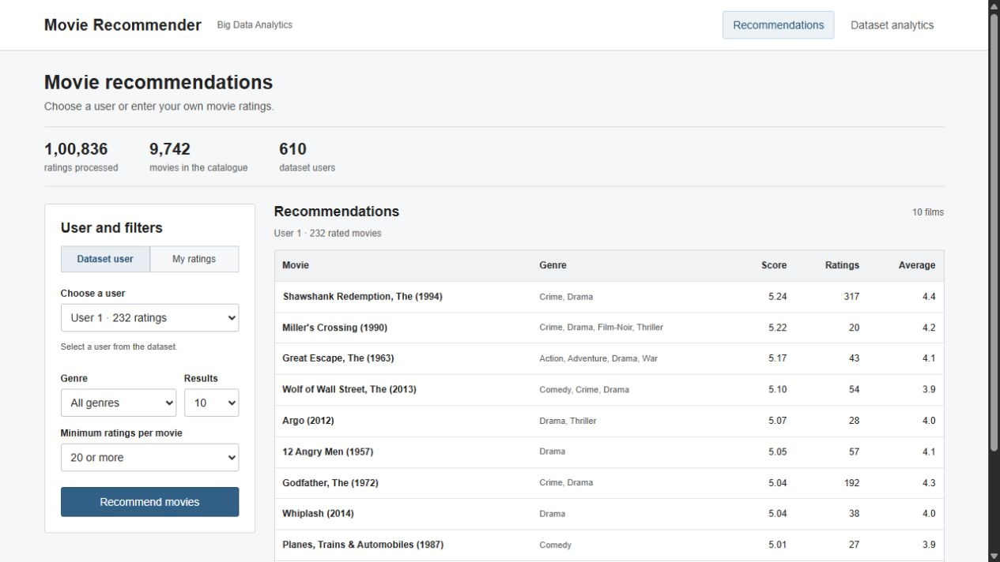

# Movie Recommendation System

## What it does

- Suggests movies based on a user's ratings.
- Lets you select an existing user or enter your own ratings.
- Excludes movies the user has already rated.
- Filters results by genre and rating count.
- Shows dataset statistics and prediction errors.

## How it works

1. Read `ratings.csv` and `movies.csv` from MovieLens.
2. Remove invalid records and duplicate user/movie pairs.
3. Join the ratings with movie details.
4. Learn user and movie preference vectors using ALS.
5. Compare the vectors to score unseen movies.
6. Return the highest-scoring movies that match the filters.

For a new user, the selected movie ratings are used to calculate a user vector. The entire model is not retrained for each request.

## Dataset

- 100,836 ratings, 610 users and 9,742 movies.
- Ratings range from 0.5 to 5 in half-star steps.
- `ratings.csv`: user ID, movie ID, rating and timestamp.
- `movies.csv`: movie ID, title and genres.
- Tags and links are included with the original download but are not used.
- Source and licence: [GroupLens MovieLens](https://grouplens.org/datasets/movielens/latest/) and [original README](data/ml-latest-small/README.txt).
- Dataset and derived files are subject to the original research/noncommercial conditions. See [third party notices](THIRD_PARTY_NOTICES.md).

## Run the project

Windows:
```bat
setup.cmd
run.cmd
```

Linux/macOS:
```bash
bash setup.sh
bash run.sh
```

- Open **http://127.0.0.1:8080**. Ctrl+C stops the server.
- Setup installs missing dependencies and builds the project. Internet is needed the first time.
- Windows setup uses winget when JDK 17 is missing. Linux setup supports apt; macOS requires Homebrew.
- Other systems need JDK 17, curl and unzip installed first.
- Full execution was tested on Windows. Linux/macOS scripts were checked for syntax only.
- Allow about 4 GB RAM and 2 GB free disk space for training.
- To train again: `train.cmd` or `bash train.sh`.
- To use another port: `run.cmd --port 8081`.

## Tools used

- Java 17: training code, recommendation logic and local server.
- Spark 3.5.7: CSV processing, SQL analysis, RDD operations and ALS training.
- Maven 3.9.11: dependencies and build.
- HTML, CSS and JavaScript: browser interface.
- No API key or external database is needed.

## Results

Each user's earliest 80% of ratings train the model. The remaining ratings test it.

| Measurement | Result |
|---|---:|
| Training / test ratings | 80,419 / 20,417 |
| Scored / excluded test rows | 18,715 / 1,702 |
| Coverage | 91.66% |
| ALS RMSE / MAE | 0.9316 / 0.7176 |
| Mean baseline RMSE | 1.0569 |

- Lower error is better. These numbers are not accuracy percentages.
- The baseline and ALS use the same scored rows.
- Settings: 12 factors, 10 iterations, regularisation 0.1, seed 42.
- After evaluation, the app's model is trained on all ratings.
- All 16 unit tests passed; the full training run and API checks passed.

## Main files

| File or folder | Purpose |
|---|---|
| `src/main/java/college/bda/TrainPipeline.java` | Cleaning, analysis, training and evaluation |
| `src/main/java/college/bda/Recommender.java` | Movie scoring and filters |
| `src/main/java/college/bda/WebServer.java` | Browser requests and responses |
| `web/` | Interface |
| `artifacts/` | Trained model, results, JSON documents and Parquet data |
| `report/` | Word report |
| `docs/VIVA.md` | Short project explanation |
| `sql/` | SQL queries and optional database examples |

## Limits

- Historical, small dataset; the app runs on one computer.
- The split is per user, not one global date cutoff.
- Movies without learned factors cannot receive an ALS score.
- Scores can exceed 5; they are model estimates, not star ratings.
- New ratings are temporary and are not added to the CSV files.
- Ranking precision/recall and new-user quality have not been measured.
- HDFS, Hive and MongoDB examples need separate services; they are not part of the running app.


